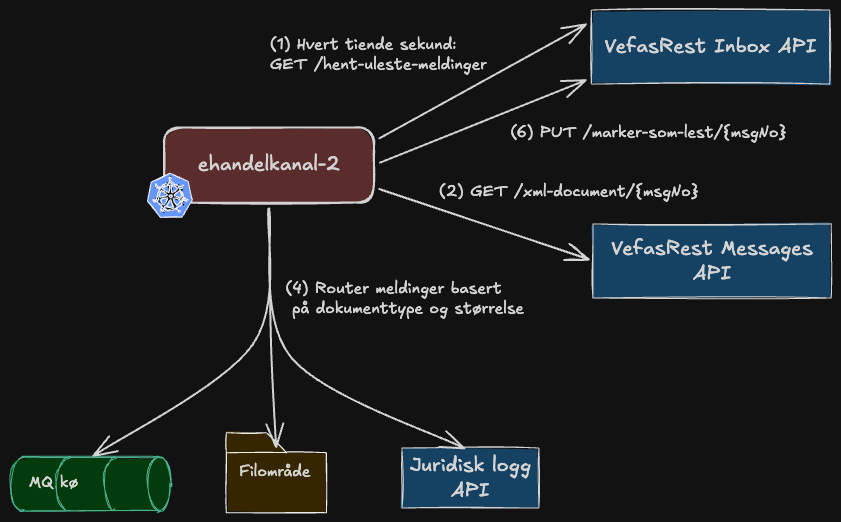

ehandelkanal-2
==============

Tjenesten håndterer EHFs mottatt fra NAV's PEPPOL ved å pulle et aksesspunkt fra
[VefasRest Inbox API ](#avhengigheter) hver tiende sekund, og route tilhørende meldinger til enten et [filområde](#avhengigheter)
eller en [MQ meldingskø](#avhengigheter) basert på dokumenttype og størrelse.
Fra kø og filområde hentes meldingene av en annen tjeneste og leverer de til eyeshare.

Tjenesten benytter mye utdatert teknologi ettersom det er blitt gjort minimalt med vedlikehold siden 2019.
Det er forventet at tjenesten skal fases ut etter at det blir gjort anskaffelse på en ny tjeneste som skal håndtere mottak
og håndtering av EHF-fakturaer. Det er uklart når dette vil skje.

## Arkitektur 

## Funkjsonalitet
Hver tiende sekund trigges følgende prosess:
1. Kall `GET /hent-uleste-meldinger` mot VefasRest Inbox API for å hente liste over nye EHF-fakturaer
2. Kall  `GET /xml-document/{msgNo}` mot VefasRest Message API for å hente meldingspayload i xml format
for de listede nye meldingene
3. Validerer xml 
4. Router meldinger basert på Dokumenttype og størrelse
5. Lagrer xml i juridisk logg gjennom access punkt (kun for Invoice/CreditNote under størrelsesbegrensning)
6. Kall `PUT /marker-som-lest/{msgNo}` mot VefasRest Inbox API for å markere at meldingen er blitt lest
7. Logger metadata om prosesserte meldinger til PostgreSQL-database on prem for rapportering.
Tjenesten eksponerer også et `/reports`-endepunkt for å hente rapporter over prosesserte meldinger.

### Routing av meldinger (punkt 4)
Meldinger routes ulikt avhengig av dokumenttype og filstørrelse:

| Dokumenttype | Filstørrelse | Destinasjon | Juridisk logg? |
|---|---|---|---|
| **Invoice** | ≤ 20 MB | Filområde via FTP | ✅ Ja |
| **Invoice** | > 20 MB | Filområde via FTP | ❌ Nei |
| **CreditNote** | ≤ 20 MB | Filområde via FTP | ✅ Ja |
| **CreditNote** | > 20 MB | Filområde via FTP | ❌ Nei |
| **OrderResponse** | Alle størrelser | MQ | ❌ Nei |
| **Catalogue** | ≤ 100 MB | MQ | ❌ Nei |
| **Catalogue** | > 100 MB | Filområde via FTP | ❌ Nei |
| **Unknown/Andre** | Alle størrelser | Eget filområde via FTP (manuellBehandling) | ❌ Nei |

**Størrelsesgrenser:**
- Juridisk logg: 20 MB (20 000 000 bytes)
- Catalogue MQ-grense: 100 MB (100 000 000 bytes)

**Referanse i koden:**
- Routing-logikk: `src/main/kotlin/no/nav/ehandel/kanal/camel/routes/Inbound.kt` (linje 145-175)
- Størrelseskonstanter: `LEGAL_ARCHIVE_SIZE_LIMIT` (linje 30) og `catalogueSizeLimit` i `Configuration.kt` tj
## Avhengigheter
- **Filområde via FTP** - tidligere koblet sammen med EBASYS, brukes for å lagre Invoice, CreditNote og store Catalogue-filer
- **Meldingskø (MQ)** - brukes for OrderResponse og små Catalogue-meldinger
- **PostgreSQL database (on prem)** - lagrer metadata om prosesserte inbound i databasen og eksponerer disse via `/reports`-endepunktet
- **VefasRest Inbox API** - brukes for å sjekke etter nye meldinger og markere dem som lest
  - Swagger (dev): https://sokos-vefasrest.intern.dev.nav.no/api/inbox/docs
  - Endepunkter: 
    - `GET /hent-uleste-meldinger` - Henter liste over uleste meldinger
    - `PUT /marker-som-lest/{msgNo}` - Markerer melding som lest
- **VefasRest Messages API** - brukes for å hente meldingspayload (XML)
  - Swagger (dev): https://sokos-vefasrest.intern.dev.nav.no/api/messages/docs
  - Endepunkter:
    - `GET /xml-document/{msgNo}` - Henter XML-payload for en melding
- **Juridisk logg** - brukes for å lagre Invoice og CreditNote under 20 MB for etterfølgende tilgang ved nedetid
- **`/reports` endepunkt** - tjenesten eksponerer egne endepunkter for rapportering (beskyttet med Azure AD via NAIS):

## Hvordan kjøre lokalt
Applikasjonen kan bygges lokalt ved å kjøre `./gradlew clean build`

Det har ikke blitt satt opp noen enkel måte å kjøre tjenesten lokalt på, ettersom det krever kontakt med nødvendige
avhengigheter (filområde, meldingskø, access points).

Ny funksjonalitet testes i dev-fss etter merge til main. Dependabot bruker også denne testinstansen
midlertidig før merge. Avtal funksjonell testing i dev slik at den ikke kolliderer med bot-deployer.

## Testing
PR-er kjører `./gradlew --warning-mode all clean build shadowJar`, inkludert tester med mockede
integrasjoner. Image-røyktesten kontrollerer Java 21, `JDK_JAVA_OPTIONS`, Nais-truststore og Europe/Oslo.
Den kjøres før main-deploy og før Dependabot-deploy. Vanlige PR-er publiserer eller deployer ikke image;
Dependabot-jobben hoppes over og tar ikke dev-låsen for slike PR-er.

Vellykket utrulling er ikke bevis på at hele fakturaflyten fungerer. Henting av testfaktura,
routing til MQ/FTP/arkiv, databaseføring og lest-markering verifiseres separat i dev.

## Deploy
Utvikling skjer på feature-/fix-brancher med PR mot main. Bruk squash-merge og referer til Jira-saken.
Merge til main bygger og tester, publiserer image og deployer automatisk til dagens `ehandelkanal-2`
i dev-fss. Workflowen venter på utrulling og lagrer kjent fungerende image-digest, commit og
dev-konfigurasjon som artifactet `dev-main-baseline`.

Prodsetting startes manuelt med **Build, push, and deploy** på main og `deploy_prod=true`.
Standardverdien er `false`. Kjøringen verifiserer først en ny build i dev; prod-jobben venter deretter
på godkjenning i GitHub environmentet `prod-fss:team-oebs`. Prod bruker samme image-digest som
denne dev-kjøringen, uten nytt image-bygg. Kontroller commit og digest i kjøringens sammendrag,
og verifiser funksjonaliteten i dev før prod godkjennes. Push deployer aldri automatisk til prod.

### Dependabot

Workflowene følger mønsteret i [okonomimodell-api](https://github.com/navikt/okonomimodell-api/tree/main/.github/workflows),
tilpasset Gradle og FSS. Dependabot-PR-er mot main bygger, tester og kjører image-røyktesten før
PR-imaget deployes til **dagens dev-app med dagens testressurser**. Det opprettes ingen ekstra
app, identitet, database, kø eller filområde.

Main-deploy og Dependabot bruker samme dev-lås. Før PR-deploy hentes sist verifiserte main-grunnlag;
etter testen gjenopprettes dette imaget og den lagrede konfigurasjonen, også hvis PR-deploy feiler.
Dependabot-sjekken blir bare grønn når PR-testen og gjenopprettingen har lykkes.

Artifactene `dev-deploy-started`, `dev-main-baseline` og `dev-restored` registrerer deploy-tilstanden.
Hvis siste registrerte deploy ikke er fullført/gjenopprettet, eller main-grunnlaget mangler eller
er utløpt, stoppes neste PR-deploy før dev endres. Artifactene beholdes i 30 dager; kjør en ny
main-deploy hvis grunnlaget er utløpt. Ikke slett disse artifactene mens bot-deploy brukes.

Ved avbrudd eller feilet gjenoppretting: kontroller digest/commit i kjøringens sammendrag og artifact,
og kjør hovedworkflowen på gjeldende main med `deploy_prod=false` for å etablere kjent dev-tilstand
igjen. Ikke tving videre auto-merge eller slett tilstandsmarkørene for å omgå feilen. Ved behov for
eldre kode må den tas tilbake gjennom en gjennomgått main-endring. Kontroller databasekompatibilitet først.

Auto-merge kopierer referansens policy: **major, minor, patch og unknown**, med auto-approve,
squash og blackout-perioder. Dette er bevisst bredere enn bare patch/minor. Java 27 skal fortsatt
stoppes av Java 21-røyktesten. Overgang til Digestabot håndteres separat.

### Endringer som kan brekke

| Endring | Konsekvens |
|---|---|
| Dependabot erstatter dev-versjonen midlertidig | Manuell testing kan treffe en PR-versjon i stedet for main. |
| Dev bruker `Recreate` | Gammel pod avsluttes før ny starter, med nedetid under utrulling. Dette hindrer normal rolling-update-overlapp av pollere; prod-strategien er uendret. |
| PR-en kjører mot vanlige testressurser | Meldinger kan behandles og markeres lest; MQ-/FTP-/arkiv-/DB-effekter reverseres ikke av image-gjenoppretting. |
| Flyway kjøres ved oppstart | En databaseendring kan gjøre gammelt image inkompatibelt. Automatisk gjenoppretting er ikke en database-rollback. |
| Readiness blir grønn | Dette er en utrullingskontroll, ikke full kontroll av bakgrunnsinitialisering eller eksterne integrasjoner. |
| Runneren forsvinner eller workflowen avbrytes hardt | Cleanup kan utebli. Neste PR-deploy blokkeres til main har etablert kjent tilstand. |
| master/dev erstattes av main | Branch-filtre, bot-PR-er, Nais/OIDC og påkrevde sjekker må oppdateres samlet. |

### Oppsett og overgang til main

Repo-administrator må konfigurere dette før bot-auto-merge og prodsetting aktiveres:

- Installer en repo-avgrenset GitHub App med **Contents: read/write**, **Pull requests: read/write**,
  **Checks: read** og **Commit statuses: read**. Legg App-ID i variabelen `CLIENT_ID` og nøkkelen i
  secret `PRIVATE_KEY`. App-tokenet gjør at merge utløser vanlig main-deploy.
- Beskytt main med påkrevde sjekker **Run tests** og **Verify dependabot deploy**, oppdatert branch
  før merge og uten bot-bypass. Aktiver repoets **Allow auto-merge**.
- Lukk eller flytt gamle Dependabot-PR-er mot dev før auto-merge aktiveres. Auto-merge-workflowen
  stopper hvis slike PR-er finnes, siden referansens action ikke begrenser seg til main-PR-er.
- Konfigurer godkjennere og main-begrensning i `prod-fss:team-oebs`. Hindre egen godkjenning og
  administrator-bypass der dette støttes. YAML-en alene gir ingen menneskelig godkjenningsport.
- Verifiser Nais-/OIDC-tilgang for main og Dependabot-PR-er. `dev-fss:team-oebs` må tillate disse
  PR-deployene; PR-jobbene skal ikke ha prod-tilgang.

Ta workflow-endringene inn på master før navnebyttet: de nye deploy-jobbene kjører bare fra main,
så denne mergen deployer ikke til prod. PR-filteret støtter master midlertidig for migrerings-PR-en.
Kontroller gamle kjøringer først; nye workflow-filer stanser ikke allerede startede eller ventende
prod-deployer som bruker den gamle workflowen.
Bytt deretter standardbranch til main og kjør første vellykkede main-deploy til dev for å opprette
gjenopprettingsgrunnlaget. Håndter gamle dev-PR-er før auto-merge aktiveres. Verifiser Dependabot-deploy,
gjenoppretting og merge-trigger før `dev/ehandelkanal-2` slettes. Den gamle dev-branchen har fortsatt
sin gamle deploy-workflow til den avvikles; ikke push eller merge dit under overgangen.
Fjern master fra PR-filteret etter overgangen.

**Rød sone — forstå dette grundig:** delte fakturakilder, databaseoppstart, PR-rettigheter,
gjenoppretting og prod-godkjenning. Bruk bare avtalte testdata i dev.

## Alarmer i FSS

Alarmene bruker `PrometheusRule`, som i okonomimodell-api, med egne filer for
[dev-fss](.nais/prometheusrule-dev.yaml) og [prod-fss](.nais/prometheusrule-prod.yaml).
Reglene bruker dagens simpleclient-metrikker, ikke Spring/Micrometer-navn fra referansen.
Cluster, namespace og app avgrenses i uttrykkene. Resultatene samles per app, ikke per pod.

**AlertmanagerConfig settes opp av andre og er ikke del av dette repo-oppsettet.**
Følgende labels er avtalen med den som setter opp rutingen:

| Label | Dev | Prod |
|---|---|---|
| `namespace` | `team-oebs` | `team-oebs` |
| `app` | `ehandelkanal-2` | `ehandelkanal-2` |
| `env` | `dev-fss` | `prod-fss` |
| `alert_type` | `custom` | `custom` |

`alert_type=custom` velger bort standardruten. **Uten en fungerende egendefinert rute
kan reglene evaluere uten at noen får Slack-varsel.** AlertmanagerConfig må matche avtalen
over og bruke `httpConfig.proxyUrl: http://webproxy.nais:8088` i `slackConfigs` for FSS.
Avtal mottakere, reaksjonstid og hvem som følger opp varsler utenfor arbeidstid.
Anbefalt gruppering er `namespace`, `app`, `env` og `alertname`, med `sendResolved: true`.
Grupper retries og flere pods; ikke send ett Slack-varsel per logglinje. Vurder å dempe
sekundære varsler når appen er utilgjengelig, men ikke skjul arkiverings- eller leveringsfeil.

### Utrulling og aktivering

Workflowen **Validate and deploy FSS alerts** validerer reglene på PR-er, også mot master
under overgangen. Endringer i alarmfilene på main deployer automatisk til dev-fss.
Prod krever manuell kjøring på main med `deploy_prod=true`, vellykket dev-deploy og godkjenning
i `prod-fss:team-oebs`. Workflowen endrer bare alarmregler, ikke app eller AlertmanagerConfig.
`WAIT=false` brukes fordi reglene ikke har en app-utrulling å vente på; deploy er ikke
bekreftelse på at uttrykkene gir data eller at Slack-rutingen virker.

Før aktivering må ansvarlig for rutingen kontrollere følgende i begge FSS-miljøene:

- Verifiser faktiske `cluster`-, `namespace`- og `container`-labels i Grafana, og at alle
  metrikknavnene i reglene finnes. Kontroller også `kube_pod_container_status_last_terminated_reason`.
- Kontroller at det ikke allerede finnes tilsvarende regler for appen som gir dobbeltvarsling.
- Kontroller regelstatus og prøv hele varslingskjeden med en avtalt testalarm, inkludert resolved.
  Ikke stopp prod-appen eller fremprovoser en fakturafeil for å teste rutingen.
- Se over terskler og konsekvens sammen med driftsansvarlig før prod godkjennes.

Lokalt kjøres `bash .github/smoke/test-alerts.sh` med Ruby og `promtool` på PATH.
En annen promtool-sti kan gis som første argument. CI henter en fast versjon med verifisert
SHA-256. Testene dekker utløsning, ventetid, counter-reset, fravær av data, miljøskille og opphør.

### Terskler og betydning

Dette er startverdier som må justeres etter normal drift. Dev har lengre ventetid ved
utilgjengelighet og manglende målinger for å tåle `Recreate` og Dependabot-testing.

| Alarm | Utløsning | Prod | Dev |
|---|---|---|---|
| `EhandelkanalUnavailable` | Ingen tilgjengelige replikaer | critical etter 5 min | warning etter 15 min |
| `EhandelkanalMetricsMissing` | JVM-heap-målingen er fraværende | warning etter 10 min | warning etter 20 min |
| `EhandelkanalHeapPressure` | Heap over 85 % i 10 min | warning | warning |
| `EhandelkanalRepeatedRestarts` | Mer enn 3 restarter siste time | warning | warning |
| `EhandelkanalOomKilled` | OOMKilled og restart siste 10 min | critical | warning |
| `EhandelkanalLegalArchiveFailed` | Arkiv-retries er brukt opp siste 10 min | critical | warning |
| `EhandelkanalManualDeliveryFailed` | Levering til feilmappen feilet etter retries siste 10 min | critical | warning |
| `EhandelkanalReportWriteFailed` | Rapportlagring feilet etter retries siste 10 min | warning | warning |
| `EhandelkanalManualProcessing` | Feilruten har levert til manuell behandling siste 10 min | warning | warning |
| `EhandelkanalXmlParsingFailed` | XML-tolkning ved rapportuttrekk feilet siste 10 min | warning | warning |

Hendelsesalarmene utløses ved økning større enn null, uten ekstra `for`-ventetid.
En permanent arkiveringsfeil skal ikke skjules av lav trafikk eller en prosentgrense.
At slike alarmer går til resolved betyr bare at hendelsen har falt ut av tidsvinduet,
**ikke** at dokumentet er rettet eller arkivert. Fravær av målinger påvirkes også av
Prometheus sin lookback-periode; feil i selve alarmmotoren må overvåkes av plattformen.

### Driftsrutiner for alarmer

Start med miljø og tidsrom fra alarmen. Kontroller deployment og logger i riktig FSS-cluster,
ikke en GCP-instans. Bruk godkjent logg-/fagsystem for å finne berørte meldinger.

| Type feil | Kontroller og følg opp |
|---|---|
| Utilgjengelig, restart eller OOM | Deployment, pod-events og forrige container-logg. FTP-test og Vault-/DB-bakgrunnsjobber kan stoppe appen. Se på minne og dokumentstørrelser før ressursendring. |
| Målinger mangler | Pod, `/internal/prometheus`, scrape-target og datakilde. JVM-målingen skal finnes også når det ikke kommer dokumenter. |
| Juridisk arkiv | Finn manglende arkivering og avklar videre oppfølging. Appen kan ha fortsatt levering etter arkivfeilen. Dokumenter over 20 MB hopper normalt over arkivet og utløser ikke denne telleren. |
| Manuell levering feilet | Kontroller FTP, rettigheter, kapasitet og faktisk innhold i manuellBehandling. Avklar om dokumentet fortsatt er ulest. |
| Rapportlagring | Kontroller PostgreSQL, credentials-fornyelse og resultatet av feilruten. Retries kan ta lang tid før telleren økes. |
| Manuell behandling / XML | Undersøk formatfeil og behandle dokumentet etter avtalt rutine. XML-telleren dekker ikke alle mulige XML-/SBDH-feil, og feil-telleren dekker ikke alle manuelle løp. |

**Rød sone — forstå dette grundig:** Levering til FTP/MQ/arkiv og markering som lest er
ikke én atomisk operasjon. Ikke marker dokumenter lest, send fakturaer på nytt eller start
parallell behandling uten å ha avklart leveringsstatus og duplikatfare. Slack-varsler og
metrikklabeller skal ikke inneholde XML, body, headers, fakturanummer, leverandørdata eller token.

### Målinger og oppsett som fortsatt bør forbedres

Første versjon endrer ikke behandlingslogikk, readiness eller eksisterende tellere.
Den dekker derfor ikke hele fakturaflyten:

- Mål vellykket polling, pågående arbeid, behandlingsfremdrift og restansealder. Varsle om
  stillstand med arbeid som venter, ikke om lav trafikk alene. Terskler må ta høyde for store batcher.
- Mål vedvarende nedlastingsfeil og feil ved markering som lest. Sistnevnte kan gi ny behandling
  av allerede leverte dokumenter. Bruk faste integrasjons-/operasjonslabels, ikke meldings-ID-er.
- Skill leveringsresultat for MQ, FTP, arkiv og manuell behandling. Dagens `messages_successful`
  økes før lest-markering og i enkelte avviksløp; den er ikke et ende-til-ende-SLO.
- Registrer meldingstellerne ved oppstart og vurder hvordan første feil skal fanges opp.
  `Metrics` initialiseres i dag ved første bruk. `increase` krever minst to observasjoner og
  kan ikke oppdage en feil som allerede inngår i første scrape eller skjer mellom scrapes før restart.
- Instrumenter HikariCP, vedvarende Vault-fornyelsesfeil og HTTP-klientresultater før slike
  regler legges til. Referansens `hikaricp_connections_pending`, `logback_events_total` og
  Spring HTTP-metrikker finnes ikke automatisk her.
- Avklar store kataloger: filskrivingen er kommentert ut i `Inbound.kt`, mens løypa logger
  vellykket levering til filområde. Dette må avklares som forretningslogikk, ikke løses med alarmtekst.
- Gjennomgå readiness etter asynkron DB-initialisering. Ikke gjør liveness avhengig av alle
  eksterne tjenester; det kan gi restartstormer uten å rette integrasjonsfeilen.
- Fjern unødvendig body-/header-logging før eventuelle loggbaserte alarmer innføres.

Kilder: [Nais-regelreferanse](https://docs.nais.io/observability/alerting/reference/prometheusrule/),
[egendefinert ruting og FSS-proxy](https://docs.nais.io/observability/alerting/how-to/prometheus-advanced/),
[varslingsstrategi](https://docs.nais.io/observability/alerting/) og
[referanserepoets alarmregler](https://github.com/navikt/okonomimodell-api/blob/df141c348781c59463158f6bdf6f328661195eec/.nais/prometheusrule-dev.yaml).

## Dokumentasjon
Det eksisterer ingen dokumentasjon på tjenesten utover denne readme-filen, så det bør gjøres oppdateringer her 
ved endring av funksjonalitet. 
